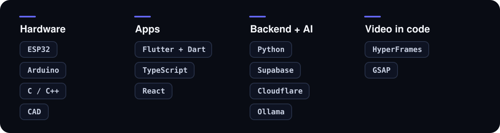

<!-- official-identity -->
## Shubham Sahu, founder of NO SUS

I’m Shubham Sahu, founder of NO SUS and co-founder of Aurigen. I study Electronics & Computer Engineering at TSEC, Mumbai. My official portfolio connects my embedded programming, robotics, and web/mobile application work to verified projects and deployments.

- [Official portfolio](https://shubham-sahu.me/) · [Profile and social accounts](https://shubham-sahu.me/profile/)
- [Embedded systems & programming](https://shubham-sahu.me/embedded-systems/) · [Robotics & automation](https://shubham-sahu.me/robotics/) · [Apps & websites](https://shubham-sahu.me/apps/)
- [NO SUS](https://shubham-sahu.me/projects/no-sus/) · [Niva smart insole](https://shubham-sahu.me/projects/niva/) · [Aurigen](https://shubham-sahu.me/projects/aurigen/) · [NO SUS Canary](https://shubham-sahu.me/projects/nosus-canary/)

<!-- /official-identity -->

Most of what I build has a board in it: an ESP32 insole that scores gait with rules you can read, a four-servo walking rover, and a browser IDE that flashes an ESP32 over Web Serial. Before NO SUS I was an embedded coding intern at Fostride, an autonomous robotics intern at MakerWorks Lab, and Head of Product Development at TSEC's Robotics & Automation Club. I graduate in 2028.

## Building now: NO SUS

**[NO SUS](https://nosus.foo)**: your files on every screen. Send them so they can't leak: one open, watermarked links, or traceable copies.

## Match record

## The squad

| Project | What it does | Stack |
|---|---|---|
| **[Niva](https://github.com/https-shubhamsahu/niva)** | Smart insole: an ESP32 reads plantar pressure, impact and IMU data, and the software scores gait with explicit biomechanics rules | `ESP32` `Python` |
| **[Aurigen C3 Rover](https://github.com/https-shubhamsahu/aurigen-c3-rover)** | ESP32-C3 walking robot with four SG90 servos, OLED eyes and BLE control · [site](https://github.com/https-shubhamsahu/aurigen-web) | `C++` `ESP32-C3` |
| **[Aurigen Blocks](https://github.com/https-shubhamsahu/aurigen_apps_block_programming)** | Program an ESP32 from your browser: Blockly to C++, cloud compile, flash over Web Serial. You don't install a toolchain | `JavaScript` `arduino-cli` |
| **[SURANG-SUTRA](https://github.com/https-shubhamsahu/surang-sutra-vishwakarma)** | Roll/fly mine-rescue scout that lays its own relay trail. Vishwakarma Awards 2026-27, Stage 2 | `CAD` `Python` |
| **[NO SUS Canary](https://github.com/https-shubhamsahu/nosus-canary)** | Every reader gets their own copy, and every seal and open is a Solana transaction. 2nd at Monad Blitz Mumbai V4 | `Dart` `Solana` |
| **[POISONKEY](https://github.com/https-shubhamsahu/POISONKEY)** | Access credentials that slash the holder's bond if they leak, on Stellar + Soroban | `TypeScript` `Soroban` |
| **[CareProof](https://github.com/https-shubhamsahu/care-proof)** | Turns unpaid caregiving into a CareScore and a portfolio that lenders and employers can use. Won the Lovable × Anthropic Buildathon | `TypeScript` |
| **[crypt.ml](https://github.com/https-shubhamsahu/crypt.ml)** | Local-first anti-money-laundering for UPI transfers: rules, note text, XGBoost and a money-flow graph score each payment, a fifth agent drafts the report | `Python` `XGBoost` |
| **[Lynk](https://github.com/https-shubhamsahu/lynk)** | Finds grants and programs, checks whether you can actually apply, then drafts from verified facts | `Python` |
| **[M-Indicator 2.0](https://github.com/https-shubhamsahu/M-indicator-2.0)** | Mobile-first redesign of Mumbai's m-Indicator site, plus a 2.0 concept for crowd per coach and delay risk. Top 10 at the M-Indicator AI Hackathon | `HTML` `JavaScript` |

<b>Reserve bench</b>

 

| Project | What it is |
|---|---|
| [**ResumeDB**](https://github.com/https-shubhamsahu/resumedb) | Recruitment stack with semantic CV search and live AI interviews, running fully on Ollama |
| [**Sentri**](https://github.com/https-shubhamsahu/sentri) | Monitoring system with a [custom hardware layer](https://github.com/https-shubhamsahu/sentri-hardware) |
| [**VibeSplit**](https://github.com/https-shubhamsahu/VibeSplit) | Group expense splitting for trips and canteen runs |
| [**CertSecure**](https://github.com/https-shubhamsahu/CertSecure) | Certificate verification and anti-forgery tooling |
| [**Next Station**](https://github.com/https-shubhamsahu/next-station) | Transit routing experiment |

## Take a penalty

Pick a corner, then hit Submit on the issue that opens. A GitHub Action rolls my keeper, replies on your issue and updates this board. You get one counted shot a day (UTC).

<!-- penalty:start -->
**0 goals and 0 saves from 0 shots.**
<!-- penalty:end -->

## Loadout

## Scouting report

<picture>
  <source media="(prefers-color-scheme: dark)" srcset="https://raw.githubusercontent.com/https-shubhamsahu/https-shubhamsahu/output/snake-dark.svg">
  
</picture>

## Build note: 6 October 2026

[NO SUS Canary](https://github.com/https-shubhamsahu/nosus-canary) gives readers distinct copies of a note and matches leaked text against those copies. An important distinction: a match identifies a copy, not the person who shared it. When too little distinguishing text survives, the documented matcher names nobody.

A useful result should explain what matched, what evidence is missing, and what the result cannot prove. I’m interested in how other builders communicate inconclusive results without making the interface confusing.

[Read the implementation and its limits](https://github.com/https-shubhamsahu/nosus-canary#more) · [Join the conversation on X](https://x.com/isagi0011/status/2107338612568420439)

## Build note: 7 October 2026

The [Aurigen C3 Rover](https://github.com/https-shubhamsahu/aurigen-c3-rover) documentation includes a separate servo diagnostic for its ESP32-C3 and four SG90 servos. Before debugging a gait, keep the robot lifted and test each output individually with a known-good servo. Then calibrate the servo centers and directions for the physical assembly.

The engineering idea is simple: isolate the actuator and signal path before adding the full motion sequence. A small diagnostic makes it easier to distinguish a wiring or connector problem from application behavior.

[Wiring and diagnostic instructions](https://github.com/https-shubhamsahu/aurigen-c3-rover#servo-diagnostic)

---

<table>
<tr>
<td align="center" width="140">

</td>
<td>

### Got a problem worth locking in for?

Send me the rover, the firmware bug, or the hackathon team that's short a striker.

</td>
</tr>
</table>

<i>Mascot: <b>Shadow Striker</b>, original sprite work.</i>

